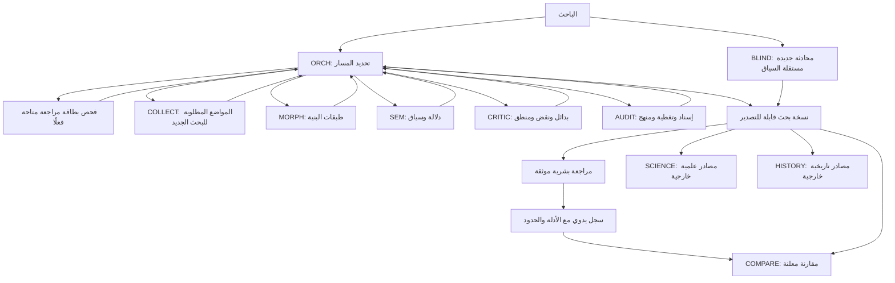

# علاقة الوكلاء ومسار البيانات

الأسهم توضح تدفق العمل، ولا تعني أن وكلاء الأطفال يتواصلون مباشرة. الأطفال الخمسة يعيدون للمنسق. لا عودة آلية من الذاكرة أو المقارنة إلى BLIND. ناتج العلم أو التاريخ يمكن أن يثير سؤالًا جديدًا محايدًا، لكنه لا يعاد تسميته شاهدًا قرآنيًا.

| نوع السؤال | المسار المعتاد | حد المخرج |
|---|---|---|
| سؤال تغطيه دراسة مراجعة متاحة | ORCH/COMPARE يفحص الإصدار والنطاق والشواهد والاعتراضات | إعادة استخدام مسندة؛ لا استقراء جديد تلقائيًا ولا ادعاء قبول غير متحقق |
| شرح المنهج أو الجاهزية | ORCH + METHOD/status | لا بحث دلالي |
| حصر مواضع أو عد | COLLECT، ثم AUDIT إذا أريد حكم كلي | الحصر للاستعلام المحدد ووحدة العد المعلنة |
| معنى موضعي | COLLECT ثم MORPH/SEM عند الحاجة ثم النقد والتدقيق المتناسب | النطاق الموضعي فقط |
| مفهوم جذر | COLLECT → MORPH → SEM → CRITIC → AUDIT | مفهوم مرشح أو عدم حسم، مع الحالات الصعبة |
| بحث مستقل السياق | BLIND مباشرة في محادثة جديدة | استقلال سياق موصوف، لا محو التدريب |
| مقارنة بما سبق | تثبيت نسخة داخلية ثم COMPARE | سجل تعرض ومقارنة؛ لا توريث اعتماد |
| علم أو تاريخ | نسخة داخلية ثم الوكيل الخارجي المناسب | مقارنة مصدرين محددين، لا إثبات إعجاز تلقائي |

التكليف يحمل السؤال والنطاق والمسموح والممنوع ومراجع الأدلة والمخرج المطلوب. انظر [قالب التكليف](../templates/HANDOFF.md). إذا نقل الأب إيصالًا لطفل أو العكس قد يفشل ارتباطه بالعملية أو الهوية أو تنتهي صلاحيته؛ يعيد المستلم استرجاع الشواهد في سياقه. لا يُحل هذا بتعطيل الفحص أو نسخ رقم بديل.

يُسمح بجولتي تعديل محددتين مبدئيًا. بعدهما تحفظ النتيجة الجزئية والاعتراضات المتبقية بدل استنزاف السياق. هذا حد تكاليف تشغيلي وليس معيار صحة، ويمكن تمديده بقرار الباحث. المهام المستقلة يمكن تجربتها بالتوازي؛ لا يصح أن ينتظر الباحث نتيجة تعتمد على دليل لم يُسترجع بعد.

AUDIT داخل السلسلة مراجعة داخلية. إذا طُلبت مراجعة مستقلة تُصدَّر نسخة ثابتة وأدلتها لمراجع في سياق جديد يبيّن تعرضه ومشاركته السابقة؛ تغيير النموذج أو اسم الوكيل وحده لا يكفي. قرار القبول لا يصدره ORCH ولا عدد الموافقين.
