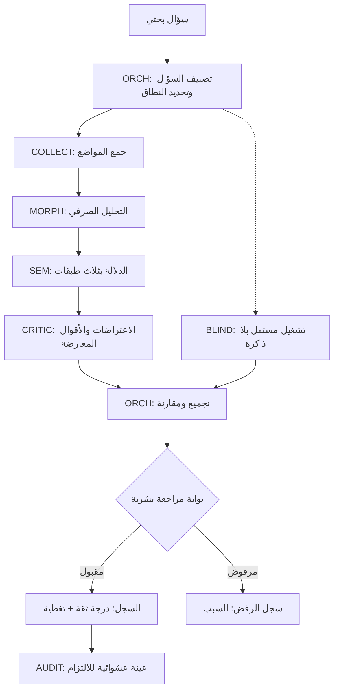

## الحكم العام

الفكرة صحيحة في اتجاهها، لكنها **مفرطة في التجزئة** على نحو سيُنتج ما حذرناك منه سابقًا: ضجيجًا مهيكلًا. اقتراحك يخلط بين ثلاثة أشياء مختلفة: **وظائف منهجية** (ما يجب أن يحدث)، و**وكلاء** (من ينفّذ)، و**مسارات بحث** (كيف يُنفَّذ). إذا حوّلت كل وظيفة إلى وكيل، ستحصل على 15 وكيلًا يتحدثون مع بعضهم، ولا أحد منهم يعرف من يملك القرار.

وقبل ذلك: **LibreChat ليست منصة تنسيق وكلاء عميقة.** هي واجهة محادثة ممتازة مع طبقة وكلاء جيدة، لكن تنسيقها المتعدد محدود بنيويًا، كما سنرى. إن بنيت عليها تصورًا يتجاوز قدرتها، ستُعيد بناء التنسيق بنفسك خارجها.

---

## أولًا: ما تقدمه LibreChat فعلاً (وما لا تقدمه)

### ما تقدمه (مؤكد في الوثائق)

| القدرة | التفصيل |
|---|---|
| **Subagents** | وكيل رئيسي يستدعي وكلاء فرعيين كأدوات، كل منهم بسياق معزول، ويعيد النتيجة للأب دون استيعاب كل أثر الأدوات |
| **Agent Chain / Teams** | رسم بياني محدود (DAG) لسلسلة وكلاء، لكل فريق نقطة دخول ووكيل يُعيد النتيجة |
| **Agent Skills** | حزم تعليمات ومراجع وسكربتات وصلاحيات، تُستدعى تلقائيًا أو عند الطلب، وقابلة لإعادة الاستخدام |
| **MCP** | ربط أدوات خارجية عبر بروتوكول موحّد، مع إدارة صلاحيات |
| **RAG** | فهرسة ملفات واسترجاع دلالي، مع `maxCitations` و`minRelevanceScore` |
| **Custom Endpoints** | أي مزوّد متوافق مع OpenAI، بما فيه نماذج محلية |
| **حدود أمان** | `maxSubagents` (افتراضي 10، حد أقصى 50)، وعمق رسم بياني محدود، و`toolApproval` بقواعد deny/ask/allow |

### القيود البنيوية التي يجب أن تعرفها قبل التصميم

1. **`handoff` واحد لكل تشغيل، وليس سلسلة هرمية.** نقاش LibreChat يؤكد: «حاليًا تسليم واحد فقط لكل تشغيل؛ هذا مقصود لأن العقد مُثبَّتة لهذه الميزة». ومشكلة موثقة: إذا سلّم A إلى B، فإن أدوات B للانتقال إلى C **لا تُنشأ**، لأن الرسم يُبنى من حواف الوكيل الأول فقط.
2. **الاستدعاء المتوازي المتزامن يفشل.** بلاغات موثقة: الوكلاء المخصصون لمهام متوازية «لا يستطيعون إنتاج مخرجات ويسقطون في خطأ».
3. **التسلسل الهرمي العميق محدود.** تجاوز عمق الرسم يُطلق خطأً صريحًا.
4. **المهارة تُنفَّذ، لكن لا تُحاسَب على السلطة.** لا يوجد في LibreChat ما يعرف «مرجع معتمد» أو «مسودة» أو «مستبدل». كل المخرجات متساوية.

**الخلاصة العملية:** LibreChat تصلح لتشغيل **وكيل منسّق + وكلاء فرعيين متخصصين**، لا لشبكة وكلاء أفقية مترابطة. أي تصور يعتمد على «وكلاء أفقيين يتحدثون مع بعضهم» سيصطدم بهذه الحدود. التصميم يجب أن يكون **هرميًا ضيقًا**، لا شبكيًا.

---

## ثانيًا: جرد الوظائف المنهجية (قبل توزيع الوكلاء)

هذه هي الوظائف التي تحتاجها المنهجية فعلًا. لاحظ أنها **أقل عددًا** من قائمة الوكلاء التي اقترحتها، وبعضها ليس وكيلًا أصلًا.

| # | الوظيفة | هل تحتاج وكيلًا؟ | ملاحظة |
|---|---|---|---|
| V1 | **جمع المواضع** للجذر/المفردة/الصيغة من المصادر | نعم | وظيفة استرجاع + تجميع، لا استنتاج |
| V2 | **التحليل الصرفي والاشتقاقي** (الجذر، الوزن، الصيغة) | نعم، لكنه **أداة حتمية** أكثر منه وكيلًا | قواعد صرفية قابلة للفحص، لا يُترك للنموذج |
| V3 | **التحليل الدلالي** (دلالة الجذر، الصيغة، التركيب، السياق) | نعم، عدة وكلاء متخصصين | يحتاج فصل الطبقات الذي أصرّت عليه وثيقتك |
| V4 | **التحليل الصوتي/الحرفي** (الحروف، ترتيبها، المؤثرات) | نعم، لكنه فرعي | مجال ضيق، يمكن أن يكون مهارة داخل وكيل لا وكيلًا مستقلًا |
| V5 | **الاعتراض والنقد** (تقديم الاعتراضات والأقوال المعارضة) | نعم | وظيفة مستقلة بالفعل، وهي **الأهم** في منهجك |
| V6 | **المنطق المجرد** (فحص الاتساق، الاستدلال، المغالطات) | نعم | يمكن دمجه مع V5 في «وكيل النقد» أو فصله |
| V7 | **التحقق العلمي/التاريخي** (التعارض/التوافق مع حقائق) | نعم، لكنه **اختياري ويُستدعى عند الحاجة** | لا يعمل دائمًا؛ يعمل كبوابة تحقق |
| V8 | **البحث الأعمى (Blind Lab)** | نعم | فكرة ممتازة، لكن تعريفها الحالي ناقص |
| V9 | **كشف تسرب المنهجية** (عدم التزام النموذج) | نعم، لكنه **مدقّق** لا باحث | وظيفة رقابية، لا معرفية |
| V10 | **تسجيل النتائج المعتمدة بدرجة ثقة وتغطية** | **لا** — هذه وظيفة **سجل**، لا وكيل | وكيل لا يكتب في السجل مباشرة؛ يمر عبر مراجعة |
| V11 | **تحسين الإخراج والعرض** | **لا** — هذه مهارة/قالب، لا وكيل | وكيل العرض يستهلك سياقًا بلا مقابل |
| V12 | **التنسيق والتجميع** | نعم، **وكيل منسّق واحد** | هو الأب في هيكل LibreChat |
| V13 | **المراجعة البشرية** | **لا** — إنسان | بوابة إلزامية، لا تُ Delegated |

**النتيجة:** من 15 وكيلًا مقترحًا، يبقى **7–8 وكلاء فعليون**، ووظيفتان تُحوَّلان إلى سجل، ووظيفتان إلى مهارة/قالب، ووظيفة واحدة تبقى بشرية. هذا الترشيد ضروري، وإلا دفع كل وكيل ثمن سياق ووقت بلا عائد.

---

## ثالثًا: إعادة توزيع الوكلاء (أفقي / عمودي / فرعي)

### المستوى الأفقي — وكيل منسّق واحد

**`ORCH` — المنسّق (Supervisor / Root Agent)**

- **دوره:** يستقبل السؤال البحثي، يحدد نوعه، يوزّع على الوكلاء العموديين، يجمع النتائج، يقرر إن كانت كافية أم تحتاج جولة أخرى.
- **لا ينتج معرفة بنفسه.** لا يحلّل ولا يستنتج؛ يوجّه ويجمع.
- **في LibreChat:** هو الوكيل الجذري (parent) الذي يستدعي الـsubagents.

### المستوى العمودي — وكلاء التخصص (خمسة فقط)

| الوكيل | الوظيفة | المدخل | المخرج | حدود صارمة |
|---|---|---|---|---|
| **`COLLECT` — جامع المواضع** | استرجاع كل المواضع من المصادر | جذر/مفردة/صيغة | قائمة مواضع مع مصدرها وموضعها | لا يستنتج معنى؛ يجمع فقط |
| **`MORPH` — الصرف والاشتقاق** | تحليل بنيوي: جذر، وزن، صيغة، موقع | المواضع | جدول صرفي قابل للفحص | **أداة حتمية + نموذج للشرح**، لا استنتاج دلالي |
| **`SEM` — الدلالة** | ثلاث طبقات منفصلة: الجذر، الصيغة، التركيب/السياق | المواضع + الصرف | قراءة دلالية لكل طبقة مع حدودها | **لا يدمج الطبقات**؛ يفصل مساهمة كل طبقة |
| **`CRITIC` — النقد والاعتراض** | تقديم الاعتراضات، الأقوال المعارضة، فحص الاتساق المنطقي | قراءة SEM | اعتراضات مصنفة + ردود محتملة | لا يحسم؛ يعرض موضع الخلاف |
| **`BLIND` — البحث الأعمى** | بحث بلا مرجعية سابقة ولا ذاكرة | السؤال فقط | نتائج مستقلة عن أي مرجع | **عزل تام**: لا يرى سجل، ولا نتائج سابقة |

### المستوى الفرعي — وكلاء يُستدعون عند الحاجة فقط

| الوكيل | متى يُستدعى | لماذا فرعي |
|---|---|---|
| **`AUDIT` — مدقّق الالتزام** | بعد كل تشغيل، على عينة | وظيفة رقابية، لا تحتاج أن تعمل دائمًا |
| **`EVID` — التحقق العلمي/التاريخي** | إذا حملت النتيجة دعوى علمية أو تاريخية | لا يعمل في كل جولة؛ اختياري |
| **`PHON` — الحروف والمؤثرات الصوتية** | إذا كان الجذر/الصيغة تستدعي ذلك | مجال ضيق، يعمل كمهارة داخل SEM لا كبديل عنه |

### ما تم حذفه ولماذا

- **«وكيل سرد الأقوال المعارضة»** → دُمج في `CRITIC`. الفصل بينهما يُنتج وكيلين يقولان الشيء نفسه بترتيبين.
- **«وكيل المنطق المجرد»** → دُمج في `CRITIC` (كأداة فحص)، أو بقي أداة داخلية. وكيل منفصل للمنطق سيُنتج مخرجات لا يعرف أحد كيف يدمجها.
- **«وكيل تحسين الإخراج»** → هذا **قالب عرض**، لا وكيل. القالب يُطبَّق على المخرجات في النهاية، ولا يحتاج نموذجًا.
- **«وكيل التسجيل بدرجة الثقة»** → هذا **سجل**، لا وكيل. `ORCH` يُرسل المخرجات إلى **سجل مركزي** يمر ببوابة مراجعة بشرية.
- **«وكيل كشف التسرب»** → بقي `AUDIT`، لكنه **مدقّق** لا باحث: يفحص هل التزم `SEM` بحدوده أم لا. لا يُنتج معرفة.

---

## رابعًا: العلاقات بين الوكلاء

### المبدأ الحاكم

**هرمية ضيقة، لا شبكة.** LibreChat لا تتحمل شبكة أفقية، والمنهجية لا تحتاجها. العلاقة الأساسية:

```
ORCH (الأب)
 ├── COLLECT
 ├── MORPH
 ├── SEM ── (يستدعي PHON عند الحاجة)
 ├── CRITIC
 └── BLIND
      └── (اختياريًا) AUDIT و EVID بعد الجمع
```

### تدفق الجولة الواحدة



### العلاقات الحاكمة بين الوكلاء (قواعد لا تُخالف)

| العلاقة | القاعدة |
|---|---|
| **ORCH ↔ الجميع** | ORCH وحده يوزّع؛ لا وكيل يستدعي آخر من تلقاء نفسه إلا عبر ORCH |
| **SEM ↔ MORPH** | SEM **يستهلك** مخرجات MORPH ولا يعدّلها. إن وجد خطأً صرفيًا، يعيد الطلب إلى ORCH، لا يصحح بنفسه |
| **SEM ↔ CRITIC** | CRITIC **يستهلك** قراءة SEM ولا يعدّلها. غايته إضعافها أو إظهار ثغراتها، لا تحسينها |
| **BLIND ↔ الجميع** | **لا يرى أي مخرج من الآخرين.** يعمل بالتوازي، ويُقارَن ناتجه بناتج المسار العادي — الفرق هو المعلومة |
| **AUDIT ↔ الجميع** | يفحص، ولا يعدّل. تقريره يذهب إلى ORCH والبشر، لا إلى الوكلاء |
| **الجميع ↔ السجل** | **لا وكيل يكتب في السجل.** التسجيل يمر عبر بوابة بشرية |

**هذه القاعدة الأخيرة هي الأهم.** إن سمحت لأي وكيل بالكتابة في السجل، فسيتحول السجل إلى أرشيف اقتراحات لا مرجع. و`BLIND` تحديدًا يجب ألا يرى السجل أصلًا، وإلا فقد غايته.

---

## خامسًا: التصور الكامل

### الطبقة 1: مصادر المعرفة (لا وكلاء)

- الملفات الأصلية والمسارات الأربعة، كما هي في `inventory.csv`.
- **لا يُعدَّل مصدر.** كل وكيل يقرأ فقط، وكل مخرج يُسجَّل بموضعه.

### الطبقة 2: السجل المركزي (لا وكلاء)

- `units.csv` بالحقول السبعة (schema v0.2).
- `relations.csv` بالعلاقات الست.
- **درجة الثقة** (`confidence`) و**نسبة التغطية** (`coverage`) كحقلين **يُملآن بشريًا** بعد المراجعة، لا يعبّئهما الوكيل.
- **سجل الرفض** (`rejected.csv`): كل مخرج رُفض، مع السبب. هذا يمنع إعادة إنتاج الخطأ نفسه.

### الطبقة 3: الوكلاء (هرمية ضيقة)

كما في القسم الرابع: `ORCH` + خمسة عموديين + ثلاثة فرعيين عند الحاجة.

### الطبقة 4: بوابات المراجعة (بشرية)

- **بوابة الاستخلاص:** كل وحدة تدخل السجل تمر بمراجعة.
- **بوابة العلاقة:** كل علاقة `conflicts_with` أو `same_as` تُراجع.
- **بوابة النشر:** أي مخرج يخرج للاستخدام العام يُعتمد.

### الطبقة 5: العرض والتشغيل

- واجهة محادثة للمنسّق.
- **فهرس مولَّد** من السجل، لا مُحرَّر.
- تقارير دورية عن: الوحدات الجديدة، الرفض، الفجوات.

---

## سادسًا: القيود والمخاطر التي يجب أن تصمم حولها

1. **`handoff` واحد لكل تشغيل.** لا تصمّم سلسلة A→B→C→D. اجعل ORCH هو من يستدعي كل وكيل مباشرة، لا سلسلة تسليمات.
2. **التوازي غير موثوق.** لا تعتمد على تشغيل `SEM` و`CRITIC` معًا في نفس اللحظة. شغّلهما تتابعيًا، أو عبر استدعاءين منفصلين يجمع ORCH نتائجهما.
3. **`maxSubagents` الافتراضي 10.** ثمانية وكلاء يقعون تحت السقف، لكن لا تُضف وكيلًا تاسعًا بلا داعٍ.
4. **لا سلطة في LibreChat.** السجل هو من يحمل `authority.level` و`status`، لا الوكلاء. أي محاولة لجعل الوكيل «يعتمد» مخرجًا ستُنتج اعتمادًا بلا دليل.
5. **`BLIND` مكلف ولا يُشغَّل دائمًا.** شغّله على عينات، أو عند وجود شك في تحيّز المرجعية. تشغيله على كل سؤال يضاعف التكلفة بلا عائد.
6. **`MORPH` يجب أن يكون أداة حتمية أولًا.** لا تترك التحليل الصرفي للنموذج وحده. استخدم قواعد/قوائم، والنموذج يشرح فقط. هذا يحمي المنهجية من الاجتهاد الصرفي غير المنضبط.
7. **`AUDIT` لا يفحص النموذج فقط، بل يفحص النظام.** هل الوحدة ارتبطت بمصدرها؟ هل السجل متسق؟ هل درجة الثقة مبررة؟ هذا أهم من فحص «هل التزم النموذج بالمنهجية».

---

## سابعًا: خارطة طريق دنيا (لا تبدأ بالثمانية)

| المرحلة | ما تنفّذه | لماذا |
|---|---|---|
| **1** | `ORCH` + `COLLECT` + `SEM` فقط، على مسألة واحدة | اختبار الهيكل الهرمي على أصغر وحدة |
| **2** | أضف `CRITIC` | اختبر تدفق «قراءة ← اعتراض» |
| **3** | أضف `BLIND` على عينات | قِس قيمة البحث الأعمى قبل تعميمه |
| **4** | أضف `MORPH` كأداة حتمية داخل `SEM` | لا تجعله وكيلًا مستقلًا قبل إثبات الحاجة |
| **5** | أضف `AUDIT` و`EVID` عند الحاجة | وظائف رقابية، تُستدعى لا تعمل دائمًا |

**لا تبنِ الثمانية معًا.** كل وكيل تضيفه يجب أن يُثبت أنه يضيف قيمة لا يستطيع غيره تقديمها. إن أضفت وكيلًا ولا تعرف ما الذي يقدمه ولا يقدمه الآخرون، فقد أضفت تكلفة سياق لا وكيلًا.

---

## الخلاصة في خمسة أسطر

1. **الاتجاه صحيح، والتجزئة مفرطة.** من 15 وكيلًا مقترحًا، يبقى **8** بعد الترشيد، ووظيفتان تصبحان سجلًا، ووظيفتان مهارة/قالبًا، ووظيفة تبقى بشرية.
2. **LibreChat تصلح لهيكل هرمي ضيق، لا شبكة أفقية.** `handoff` واحد لكل تشغيل، والتوازي غير موثوق، والعمق محدود. صمّم على هذا الأساس، لا ضده.
3. **`BLIND` فكرتك الأقوى**، لكنها تحتاج تعريفًا أدق: ماذا يقارن؟ وبأي معيار يُحكم على الفرق؟ بلا ذلك سيبقى تشغيلًا مكلفًا بلا سؤال.
4. **`CRITIC` هو قلب منهجك، لا `SEM`.** الوكيل الذي يعترض ويُظهر الثغرات أهم من الوكيل الذي يقرأ. أعطه الأولوية في التصميم.
5. **لا وكيل يكتب في السجل.** التسجيل يمر عبر بوابة بشرية، ودرجة الثقة والتغطية تُملآن بعد المراجعة، لا قبلهما. هذا هو الفرق بين نظام معرفة وأرشيف اقتراحات.
