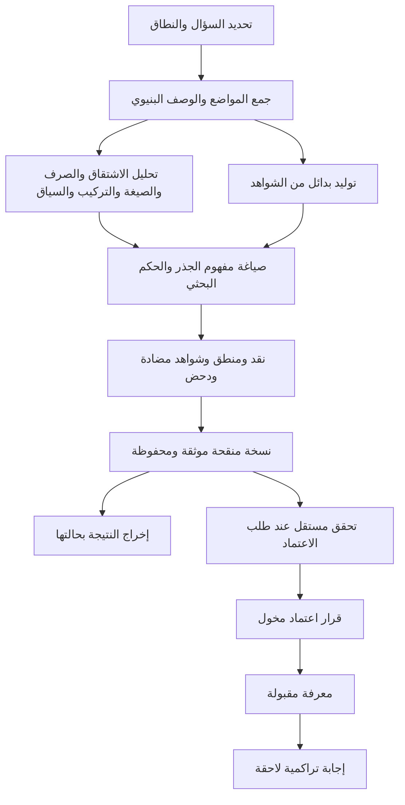

**أقترح بناء لسان على LibreChat بوصفه منظومة بحث ذات وظائف واضحة، لكل وظيفة وكيل محدد، ولكل وكيل مصادر وصلاحيات ومخرجات وعلاقات معلومة.** ويتولى محرك لسان ضبط النص والأدلة والتغطية والحفظ والاعتماد، بينما يوفر LibreChat المحادثة وتشغيل الوكلاء وعرض نتائجهم.

الجرد التالي يضم **37 دورًا وظيفيًا مقترحًا: 13 دورًا أفقيًا، و16 تخصصًا بحثيًا، و8 أدوار فرعية للتحدي والاستكشاف والمقارنة**. هذه هويات للمسؤوليات؛ ويُستدعى منها ما يحتاجه السؤال.

استندت إلى [منهجية البحث الحالية](/D:/APP/tafseer/lisanapp3/skills/lisan-semantic-extraction/SKILL.md) و[عقد الصلاحيات والحوكمة](/D:/APP/tafseer/lisanapp3/SIMPLIFIED_AI_AUTHORITY_AND_GOVERNANCE_CONTRACT.md). أما توزيع الوكلاء والأسماء والإضافات العلمية والتاريخية فهو **تصميم مقترح للمراجعة**. لم أنفذ تغييرات أو أنشئ وكلاء.

**1. المقصود بالأفقي والعمودي والفرعي**

- **الوكيل الأفقي:** يخدم مختلف البحوث، مثل التغطية والمنطق والتوثيق والإخراج.
- **الوكيل العمودي:** يتخصص في طبقة معرفية، مثل الاشتقاق أو السياق أو مفهوم الجذر.
- **الوكيل الفرعي:** يُستدعى لمهمة محددة، مثل البحث عن مثال مضاد أو اختبار فرضية عن ترتيب الحروف.

وهذان تصنيفان متداخلان: الأفقي والعمودي يصفان الاختصاص، والفرعي يصف طريقة الاستدعاء. ويمكن تشغيل ناقد أو متخصص صرفي بوصفه وكيلًا فرعيًا.

كذلك، بعض الوظائف تحتاج **وكيل خدمة يعتمد على برنامج حتمي**؛ فعدّ المواضع والتحقق من المراجع لا يصح أن يعتمدا على تقدير نموذج لغوي.

**2. الوكلاء الأفقيون: الوظائف المشتركة**

| الرمز | الوكيل والوظيفة | يستقبل | ينتج ويرتبط بـ |
|---|---|---|---|
| H01 | **منسق السؤال والبحث:** تحديد المطلوب والنطاق وتوزيع المهام | سؤال المستخدم ووضع البحث | سؤال مضبوط وخطة محدودة؛ يستدعي التخصصات اللازمة |
| H02 | **أمين المصدر والمنهج:** التحقق من المصدر والإصدار والقدرات المتاحة | مراجع المصادر والمنهج المسجلة | حزمة مصادر متحققة وحدود استخدامها؛ تخدم جميع الوكلاء |
| H03 | **مدير السياق والعزل:** بناء سياق كل وكيل وإنفاذ حدود Blind Lab | المسار المختار وقائمة المدخلات والأدوات | سياق مأذون وسجل تعرض؛ يتحكم في وصول جميع الوكلاء |
| H04 | **محقق الأدلة والإسناد:** التحقق من وجود المرجع ومطابقته | إحالات الشواهد والادعاءات | مراجع محلولة أو أخطاء محددة؛ يعيدها للباحث والمراجع |
| H05 | **محاسب التغطية والاكتمال:** حساب الحصر والتحليل بحسب نطاق الدعوى | المواضع المحصورة والمحللة وإصدار المتن | بسط ومقام وحدود تغطية؛ يخدم الحكم والدحض والاعتماد |
| H06 | **مدقق الالتزام المنهجي والتسرب:** كشف مخالفة حدود المصدر والمنهج | المدخلات الفعلية والاستدلال والمخرجات | ملاحظات مسندة تحدد الادعاء المتأثر؛ يعيدها للباحث |
| H07 | **محلل المنطق المجرد:** فحص المقدمات والنتائج واللزوم والتناقض والدوران | الحجج والافتراضات والبدائل | خريطة حجاج ونقاط ضعف؛ يخدم الباحث والناقد |
| H08 | **موثق التنفيذ والسلالة:** تسجيل ما نُفذ فعلًا | استدعاءات الأدوات والمدخلات والمخرجات والأخطاء | سجل تشغيل قابل للتتبع مرتبط بكل نتيجة |
| H09 | **أمين سجل البحث والمعرفة:** حفظ الأحكام وإصداراتها وروابطها | الأحكام والمراجعات وقرارات الاعتماد | سجلات بحث محفوظة؛ ومعرفة مقبولة فقط بقرار الجهة المخولة |
| H10 | **مسترجع المعرفة المؤهلة:** استرجاع ما يجوز استخدامه في الطلب الحالي | السؤال وهوية المستخدم وغرض الاستعمال | نتائج مؤهلة بأدلتها وحالتها؛ يخدم الإجابة التراكمية والمقارنة |
| H11 | **مراقب الاعتماديات وإعادة الفحص:** تحديد أثر الأدلة والتغييرات الجديدة | تغير مصدر أو منهج أو نتيجة معتمَد عليها | قائمة نتائج متأثرة وأسباب إعادة فحصها؛ تتولى خدمة المجال تغيير حالتها وفق العقد |
| H12 | **المراجع المستقل:** التحقق من نتيجة محددة عند طلب اعتمادها | نسخة محددة من الحكم وأدلته في سياق مستقل | سجل تحقق واعتراضات؛ يذهب إلى قرار الاعتماد ولا ينفذه بنفسه |
| H13 | **مصمم ومحرر الإخراج:** اختيار طريقة العرض وتحسين الوضوح | حزمة نتائج موثقة والجمهور المستهدف | جواب أو مقارنة أو جدول أو رسم يحفظ المعنى والحالة والتحفظات |

أهم فصل هنا هو بين **H07 والمنهجية**: سلامة الاستنتاج منطقيًا لا تثبت صحة مقدماته. وبين **H12 والاعتماد**: تقرير المراجعة لا يمنح الوكيل سلطة قبول النتيجة رسميًا.

**3. الوكلاء العموديون: طبقات البحث الدلالي**

| الرمز | التخصص والوظيفة | المدخلات الأساسية | المخرج والعلاقة التالية |
|---|---|---|---|
| V01 | **جامع مواضع الجذر أو الصيغة أو التركيب** | استعلام مضبوط ومتن متحقق | قائمة مواضع بمعرّفاتها وحدود البحث؛ إلى V02 وH05 |
| V02 | **محلل البنية والوصف اللغوي** | المواضع والبيانات البنيوية المسموح بها | تقطيع ووصف للجذر والصيغة واللواصق، مع مواضع الاشتباه؛ إلى المحللين المتخصصين |
| V03 | **باحث الاشتقاق** | العائلات الاشتقاقية وشواهدها | فرضيات مساهمة الاشتقاق والفروق بين المشتقات؛ إلى V07 وV12 وV14 |
| V04 | **باحث التصريف** | التصريفات الفعلية والاسمية وشواهدها | أثر الزمن والعدد والجنس والبناء ونحوها بحسب الدليل؛ إلى V10 وV14 |
| V05 | **باحث حروف الزيادة والعناصر الصرفية** | التجزئة الصرفية والمقارنات المناسبة | اختبار أثر الزيادة أو اللواصق؛ إلى V03 وV06 دون افتراض معنى ثابت لكل زيادة |
| V06 | **باحث الصيغ والأوزان** | الصيغة عبر استعمالات وجذور مناسبة | مساهمة الصيغة العامة وحدودها وتطبيقها الموضعي؛ إلى V12 وV14 |
| V07 | **باحث المفردة والوحدات المعجمية** | الاستعمالات والتحليل الاشتقاقي والصرفي | وصف المفردة وعلاقتها بالجذر وتمييز وحداتها المحتملة؛ إلى V12 وV14 |
| V08 | **باحث حروف المعاني والأدوات** | حروف الجر والعطف والشرط والنفي وغيرها في مواضعها | العلاقات والقيود التي تضيفها الأداة؛ إلى V09 وV10 |
| V09 | **باحث الأنماط التركيبية العامة** | تراكيب قابلة للمقارنة | أثر النمط التركيبي وشروطه؛ إلى V10 |
| V10 | **محلل التركيب والأدوار في الموضع** | العبارة المحددة ونتائج التحليل اللغوي | العلاقات وأدوار المشاركين والإحالات ونطاق النفي أو الشرط؛ إلى V14 |
| V11 | **باحث السياق والخطاب** | السياق القريب والوحدة الخطابية المناسبة | القيود التي يضيفها السياق والمخاطَب وتسلسل الخطاب؛ إلى V12 وV14 وV15 |
| V12 | **باحث مفهوم الجذر** | المواضع ونتائج فصل الصرف والصيغة والتركيب والسياق | مفهوم مشترك مرشح وحدوده، أو عدم حسم؛ إلى النقد والدحض وV13 |
| V13 | **باحث الجوار والفروق الدلالية** | مفاهيم أو مفردات متقاربة وشواهدها | المشترك والفارق المميز وطبقة الفرق ودليله؛ إلى V12 أو V14 |
| V14 | **باحث المعنى الموضعي** | مساهمات الطبقات في موضع بعينه | معنى موضعي مع بيان مصدر كل مساهمة؛ إلى V15 |
| V15 | **مركّب البيان الدلالي النهائي** | المعاني الموضعية والعلاقات والسياق والاعتراضات | بيان متكامل للآية أو التركيب؛ إلى النقد ثم H13 |
| V16 | **باحث الموضوعات والقصص والسنن والتطبيقات** | مجموعة مواضع محددة النطاق ونتائجها | علاقات موضوعية ودروس أو تطبيقات معللة، مع فصل النص عن الاستنباط |

هذا الفصل يعالج تفصيلًا مهمًا في مقترحك:

- **حروف الجذر وترتيبها** موضوع بحث مستقل.
- **حروف الزيادة والعناصر الصرفية** تدخل في بنية الكلمة.
- **حروف المعاني** تضيف علاقات داخل التركيب.

وجمعها تحت وكيل واحد باسم «دلالات الحروف» قد يؤدي إلى نسبة أثر إحداها إلى الأخرى.

كذلك، ترتيب الطبقات هو **ترتيب لنسبة المعنى إلى مصدره**، ولا يفرض تشغيلًا خطيًا جامدًا. يستطيع باحث السياق وباحث الصرف العمل على الشواهد نفسها بالتوازي، ثم يقارن الباحث المركب نتائجهم.

**4. الوكلاء الفرعيون: التحدي والاستكشاف والمقارنة**

| الرمز | الوكيل والوظيفة | ما يفعله | علاقته بالآخرين وحدوده |
|---|---|---|---|
| B01 | **مولد الفرضيات البديلة** | يبني تفسيرات منافسة ويفصل تنبؤاتها | يقدم بدائل إلى الباحث وB05؛ يمكن أن يعمل داخل Blind Lab من شواهده |
| B02 | **باحث الشواهد المضادة والحالات الصعبة** | يبحث عن المواضع التي تضغط على الفرضية أو تنقض تعميمها | يعيد أدلة فعلية إلى الباحث والناقد ومحاسب التغطية |
| B03 | **الناقد المعارض** | يقدم أقوى اعتراض ممكن على الحكم وطريقة الاستدلال | يستهلك نسخة محددة من الحكم ويطلب جوابًا أو تعديلًا معللًا |
| B04 | **عارض الأقوال المعارضة** | يجمع الأقوال الموثقة ويعرضها بإنصاف مع أدلتها | يعمل في سياق المقارنة المسموح؛ الأقوال الخارجية لا تدخل الاستقراء المعزول |
| B05 | **مختبر الدحض** | يحول شرط رفض الفرضية إلى اختبار ويجريه | يعيد نتيجة الاختبار وأدلته؛ لا يكتفي بعبارة «لم أجد تعارضًا» |
| B06 | **باحث حروف الجذر وترتيبها** | يختبر فرضيات الحروف والتتابع والتبديل على استعمالات متحققة | مسار استكشافي قابل للنقض؛ لا تُعامل فرضياته دليلًا مستقلًا على المعنى |
| B07 | **فاحص الدعاوى العلمية والتوافق والإعجاز** | يحدد الدعوى ويفحص العلم المتصل بها والأدلة والبدائل | يعمل بمصادر خارجية معلنة؛ ويرتبط بـH07 وH04 ولا يوجه البحث المعزول |
| B08 | **باحث التاريخ والوقائع والمصادر** | يحقق الأخبار والتسلسل والسياق التاريخي ويعرض اختلاف الروايات | يفصل النص القرآني عن الرواية الخارجية وعن الدرس المستنبط؛ ويتعاون مع V16 |

والفروق بين أدوار التحدي مقصودة:

- **B01 يولد تفسيرًا منافسًا.**
- **B02 يعثر على شاهد معارض.**
- **B03 ينتقد الحجة.**
- **B04 ينقل قولًا موثقًا لصاحبه.**
- **B05 يختبر شرطًا محددًا يمكن أن يسقط الفرضية.**

فالقول الذي يولده النموذج لا يصبح قولًا منسوبًا إلى باحث، وكثرة الاعتراضات لا تعوض غياب شاهد مضاد حقيقي.

**5. كيف تتعاون هذه الوكلاء؟**

العلاقة الأساسية هي **تبادل نتائج موثقة محددة الإصدار**. ويحتوي كل تكليف على:

- السؤال الجزئي ونطاقه.
- المواد التي يجوز قراءتها والأدوات التي يجوز استعمالها.
- نوع المخرج المطلوب.
- الأدلة والاعتراضات والافتراضات التي يجب التصريح بها.
- حدود المهمة وسبب العودة إلى المنسق.
- معرّفات التشغيل والمدخلات وإصداراتها.

يمكن تمثيل مسار بحث مهم عن جذر بالشكل الآتي:

تراقب خدمات المصدر والعزل والإسناد والتغطية هذا المسار كله. ويجوز أن تعيد نتيجة النقد السؤال إلى تخصص معين؛ فخلل في نسبة المعنى إلى الصيغة يعود إلى V06، بينما موضع مضاد جديد يعود إلى V01 وV12.

ويحتاج التعاون إلى قواعد واضحة:

1. **المنسق يوزع العمل؛ ولا يحسم الحقيقة بالتصويت.**
2. **كل ادعاء مادي يعود إلى شاهده الأصلي.** إعادة صياغته بواسطة ثلاثة وكلاء لا تنتج ثلاثة أدلة.
3. **تعديل الحكم ينتج إصدارًا معلومًا.** وتُعاد الاختبارات المتأثرة بالتعديل.
4. **الخلاف يبقى ظاهرًا حتى يحسمه الدليل.** ويمكن أن ينتهي البحث إلى `UNRESOLVED`.
5. **تُحدّد دورات المراجعة والتكلفة.** فإذا استنفدت، تحفظ النتيجة الجزئية وحدودها.
6. **التفويض لا يوسع الصلاحيات.** الوكيل الفرعي يخضع للقيود الفعلية نفسها التي يفرضها محرك لسان على المهمة.

**6. موضع Blind Lab في هذه المنظومة**

أقترح أن يكون **Blind Lab بيئة بحث يديرها H03، ولها باحث رئيسي يستدعي التخصصات الداخلية اللازمة**. يستطيع المستخدم التعامل معها بوصفها وكيلًا واحدًا، مع رؤية المهام الفرعية عند الحاجة.

داخل البيئة المعزولة يمكن تشغيل:

- جمع المواضع والتحليل البنيوي.
- تخصصات التحليل الدلالي.
- البدائل والشواهد المضادة والنقد والدحض.
- فحص المنطق والمنهجية.

وتُحجب عنها:

- الإجابات السابقة والذاكرة الدلالية المقبولة.
- الأقوال والتفسيرات الخارجية.
- نتائج الوكلاء العلميين والتاريخيين.
- ملخصات المحادثة أو عناوين الملفات التي تكشف النتيجة السابقة.

**المعرفة المقبولة تُستعمل في الإجابة التراكمية أو المقارنة اللاحقة.** وعند طلب بحث مستقل جديد، تُبنى له بيئة جديدة وفق حدود العزل.

أما الاختبار انطلاقًا من فرضية مأخوذة من الخارج، فيُسجل بوصفه اختبارًا لفرضية خارجية معلومة المنشأ؛ فلا يوصف بأنه استقراء أعمى.

وهناك حد يجب إعلانه: نستطيع التحقق من عزل المدخلات والأدوات أثناء التشغيل، أما المعرفة السابقة في تدريب النموذج فلا يمكن محوها بإنشاء محادثة جديدة.

**7. كيف تحفظ النتائج وتصبح مرجعًا؟**

أقترح أن يتولى H09 الحفظ، ويضبط H10 الاسترجاع، ويتابع H11 أثر التغييرات. وتفصل المنظومة بين أربعة أنواع من المحتوى:

| المحتوى | طريقة الاستعمال |
|---|---|
| المصادر والشواهد الأصلية | أساس الإسناد والتحقق |
| سجل البحث، بما فيه المرفوض وغير المحسوم | مراجعة المحاولات والاعتراضات وأسباب الفشل |
| المعرفة المقبولة لإصدار محدد | الإجابة التراكمية المسموح بها |
| الفهارس والبطاقات والرسوم | الوصول والعرض؛ ويمكن إعادة بنائها من السجلات الأصلية |

تحفظ النتيجة بحسب نوعها: السؤال، ونطاق الادعاء، والحكم، والشرح، والحد الدلالي، ونسبة كل مساهمة إلى طبقتها، والأدلة المؤيدة والمعارضة، والحالات الصعبة، وأقوى منافس، وشرط الرفض، ونتيجة الدحض، والتغطية، وإصدارات المصدر والمنهج، والتحقق والاعتماد وشروط إعادة الفتح.

ويظل النموذج الحالي للحالات محفوظًا:

- `research_state`: مرجح، غير محسوم، مرفوض.
- `canonical_state`: غير معتمد، مقبول، يحتاج إعادة فتح.

**يجوز للذكاء الاصطناعي إصدار حكم بحثي وحفظه بعد التحقق الحتمي.** أما الاعتماد الرسمي فيحتاج شروطه والتحقق المستقل وقرارًا صريحًا من صاحب الصلاحية عبر الخادم. ولا يحتاج كل بحث استكشافي إلى انتظار ذلك القرار.

**8. كيف نمثل الثقة والتغطية؟**

أوصي بأن تعرض بطاقة النتيجة **مجموعة مؤشرات تأهيل واضحة**:

| المؤشر | ما يبينه |
|---|---|
| قوة النتيجة | مقدار تمييز الأدلة بينها وبين البدائل |
| تغطية الحصر | المواضع المسترجعة مقابل مجموع متحقق منه |
| تغطية التحليل | المواضع المحللة تفصيليًا وحدود العينة |
| الحالات غير المحسومة | المواضع أو العلاقات التي بقيت مفتوحة |
| نتيجة الدحض | الاختبار المنفذ وكيف أثر في الفرضية |
| التحقق المستقل | المراجع ونطاق المراجعة ونتيجتها |

تُحسب نسب التغطية برمجيًا مع إظهار البسط والمقام. أما الثقة الرقمية في صحة الاستنتاج فتحتاج معايرة؛ والعقد الحالي لا يسمح بجعل تقدير النموذج لنفسه عتبة قبول.

كذلك، حصول البحث على تغطية كاملة لا يثبت صحة التفسير، لكنه يمنع إخفاء جزء من المادة التي يجب أن يفسرها.

**9. ضوابط خاصة بالتخصصات التي اقترحتها**

بالنسبة إلى **مفهوم الجذر**، يفحص V12 ما يفسر مساهمة الجذر بعد فصل أثر الاشتقاق والصيغة والتركيب والسياق، ويواجه جميع المواضع المؤكدة الداخلة في دعواه. ولا تعوض موافقة الأكثرية عن معالجة المثال المضاد.

وبالنسبة إلى **الحروف وترتيبها**، يضع B06 فرضيات قابلة للاختبار: ما التنبؤ؟ ما المقارنة المناسبة؟ ما الذي يمكن أن ينقضها؟ وهل تفسر الظاهرة بنية صرفية أو علاقة معجمية أخرى؟ ولا يبدأ من قاموس مفترض لمعاني الحروف بوصفه حقيقة مقررة. يتفق ذلك مع [عقد التشخيصات المنهجية](/D:/APP/tafseer/lisanapp3/docs/canonical/LISAN_PURITY_AND_STRUCTURAL_EVIDENCE_CONTRACT.md).

وبالنسبة إلى **العلوم والإعجاز**، يفصل B07 بين حقيقة تجريبية، ونظرية، وفرضية، وتوافق محتمل، واستدلال لازم، ودعوى سبق معرفي. فلكل منها متطلبات مختلفة، ويمكن أن ينتهي الفحص إلى تأييد أو تعارض أو عدم كفاية الدليل.

وبالنسبة إلى **التاريخ والدروس**، يتولى V16 استنباط العلاقات من السياق القرآني، ويتولى B08 فحص الأخبار الخارجية. ويظهر للمستخدم مصدر كل إضافة.

أما **تحسين الإخراج**، فيقترح H13 الشكل الأنسب للسؤال، ثم يتحقق من حفظ النفي والشرط والنطاق ودرجة الجزم والإسناد. فالتحرير الذي يحول «لم يحسم» إلى خلاصة قاطعة يُعد تغييرًا في النتيجة يحتاج تصحيحًا.

**10. كيف نستفيد من مكونات LibreChat؟**

| المكوّن | استعماله المقترح في لسان |
|---|---|
| Agents | تعريف الأدوار وأدواتها وتعليماتها |
| Skills | إجراءات متخصصة ذات إصدارات، مثل تحليل الاشتقاق أو عرض الفروق |
| Subagents | تكليف مؤقت ومحدود بتخصص أو اعتراض أو اختبار |
| Agent Chains | تنظيم مسارات معروفة بين الوكلاء، مع بقاء الشروط الحاكمة في محرك لسان |
| MCP وActions | الوصول إلى عمليات لسان المحددة والمتحقق منها |
| Projects والمحادثات | تنظيم ملفات البحث ومتابعتها |
| البحث في الملفات | الدراسات والمقارنات التي تسمح بمصادرها سياسة المسار |
| Memory | تفضيلات المستخدم المسموح بها؛ واسترجاع المعرفة الدلالية عبر H10 |
| Artifacts | بطاقات وجداول وخرائط وعروض مشتقة من النتائج |
| تعدد النماذج | اختيار النموذج بحسب أداء مقاس لكل وظيفة وكلفتها |

وثائق LibreChat تدعم تخصيص الأدوات والمهارات والتفويض إلى سياقات فرعية، لكن السياق المنفصل وحده لا يثبت استيفاء عزل لسان. يلزم اختبار هذا التكامل على الإصدار المختار. [المهارات](https://www.librechat.ai/docs/features/skills)، [الوكلاء الفرعيون](https://www.librechat.ai/docs/features/subagents)، [MCP](https://www.librechat.ai/docs/features/mcp).

وأوصي بأن يظل لكل نوع بيانات موضع مسؤول واضح: LibreChat يدير المحادثة، ومحرك لسان يدير سجلات البحث والأدلة والحالات. وترتبط المنظومتان بالمعرّفات والإصدارات.

**11. كيف تعمل المنظومة دون تضخم؟**

الحصر الكامل ضروري لتوضيح المسؤوليات، لكن تشغيله يتكيف مع السؤال:

| نوع الطلب | المسار المعتاد |
|---|---|
| «اجمع مواضع هذا الجذر» | المنسق، المصدر، V01، التغطية، الإخراج |
| «ما معنى هذه المفردة في هذه الآية؟» | التخصصات اللغوية المؤثرة، السياق، المعنى الموضعي، والتحقق المناسب |
| «ابحث مفهوم الجذر بحثًا مستقلًا» | Blind Lab مع تخصصات التحليل والبدائل والنقد والدحض |
| «اعرض أقوى رأي معارض» | B04 مع محقق المصادر ومحلل المنطق |
| «قارن النتيجة بما توصلنا إليه سابقًا» | H10 مع نسخة البحث المحددة، خارج الاستقراء المعزول |
| «افحص دعوى علمية أو تاريخية» | التخصص الخارجي المناسب مع الإسناد والمنطق |
| «اعتمد هذه النتيجة» | النسخة الحالية وشروط التأهيل والمراجعة المستقلة ثم القرار المخول |

ويبقى جمع بعض الأدوار في تشغيل واحد خيارًا تقنيًا إذا أثبت التقييم أنه يحافظ على حدودها. أما الفصل بين الباحث والمراجع المستقل، وبين الاستقراء المعزول والمقارنة الخارجية، فيحتاج استقلالًا فعليًا في السياق والصلاحيات.

**12. ما الذي يثبت نجاح التصور عند تنفيذه لاحقًا؟**

أقترح معايير قبول تحاول كشف الفشل مباشرة:

- محاولة تمرير جواب سابق إلى Blind Lab عبر نص أو ملخص أو وكيل فرعي.
- مقارنة الحصر والتغطية بحساب حتمي متحقق منه.
- تقديم إحالات مختلقة أو شواهد خارج النطاق.
- اختبار ما إذا كان الناقد ومختبر الدحض يكشفان عيوبًا معروفة.
- إدخال دليل معارض وملاحظة أثره في الحكم.
- التأكد من استبعاد نتيجة تحتاج إعادة فتح من الاسترجاع المقبول.
- محاولة منح نتيجة اعتمادًا من أداة متاحة للنموذج.
- قياس حفظ محرر الإخراج للتحفظات والشرط والنفي.
- مقارنة الفريق بباحث واحد يستخدم الأدوات نفسها من حيث الجودة والكلفة ووقت المراجعة.

وأرجح أن تبدأ التجربة اللاحقة بمسار واحد كامل: **سؤال عن جذر → حصر متحقق → فصل الطبقات → فرضيات → نقد ودحض → حكم محفوظ → عرض واضح**. ثم يضاف الاسترجاع التراكمي والاعتماد والمقارنات الخارجية بحسب نتائج التقييم.

بهذا يصبح لكل وظيفة موضع معلوم، ولكل خلاف طريق للفحص، ولكل نتيجة أصل يمكن الرجوع إليه.

**الخطوة التالية الاختيارية:** مراجعة سيناريو بحث واحد على الورق باستخدام هذه المصفوفة، للتحقق من اكتمال العلاقات وحدود الوصول قبل أي تنفيذ.
