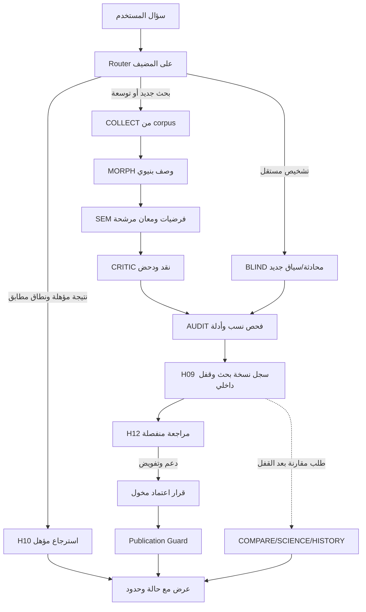

# قرار البنية المرجعية: LISAN–LibreChat governed adoption

## الهدف

الاحتفاظ بعمق منهجية «لسان القرآن» مع استغلال نماذج الذكاء الاصطناعي في التحليل الدلالي الفعلي، دون تحويلها إلى مصدر يقين أو جهة اعتماد، ودون إعادة تنفيذ قدرات LibreChat أو خادم النص القرآني الأصلي بلا حاجة. هذه **وثيقة تصور ملزم مقترح لاعتماد المالك**؛ ليست تغييرًا في المشاريع المنشورة.

## فصل خمسة أبعاد

| البعد | الكيان/المالك | طبيعة السلطة |
| --- | --- | --- |
| واجهة التفاعل والتفويض | LibreChat Agents, Skills, Subagents, Projects | تشغيل وتنسيق وعرض؛ لا سلطة دلالية |
| البحث والاستدلال | ORCH + COLLECT + MORPH + SEM + CRITIC + AUDIT؛ BLIND وCOMPARE وSCIENCE وHISTORY عند الحاجة | اقتراح بحثي قابل للتدقيق |
| المصدر القرآني | الخادم السباعي المثبت + corpus pinned + فهارس/وسوم مدعومة | إثبات نصي/عد ضمن استعلام محدد، لا حكم دلالي |
| الحوكمة المؤسسية | Policy Engine + Registry + Validation + Event Log + Publication Guard | منع وتوثيق انتقالات قابلة للتحقق |
| المراجعة والاعتماد والنشر | مراجع مستقل، صاحب اعتماد، ناشر مع مصادقة من المضيف | سلطة إدارية منفصلة عن النموذج |

## 10 وكلاء، لا 37 وكيلًا

يبقى كتالوج H01–H13 وV01–V16 وB01–B08 كاملاً (37 وظيفة) و30 طبقة؛ أما التحقق العلمي والبحث التاريخي والمقارنة الخارجية فلها نوافذ منفصلة تستدعى عند الطلب. نحتفظ بـ19 مهارة baseline ولا ننشئ مهارة مكررة لكل قيد. يجب أن يكون **تفعيل القدرة بناء على نوع الدعوى** لا تشغيل جميع التخصصات في كل سؤال.

### أدوار التنفيذ

- `ORCH`: يصنف الطلب ويدير سياقات التخصصات الخمسة الداخلية ويجمع الإجابات، لكنه لا يعتمد النتائج.
- `COLLECT`: يسترجع النصوص ويحفظ محدد البحث، عدد المطابقات والتغطية والتفسير الدقيق للمقام؛ لا ينتج حكمًا دلاليًا.
- `MORPH`: يفصل البناء الصرفي عن الفرضيات الدلالية، ويسجل مصدر كل وسم ومشاكل المحاذاة.
- `SEM`: يولد الفرضيات، يختبر الجذر والصيغة والتركيب والسياق، يقترح sense clusters ومفهوم جذر محدودًا.
- `CRITIC`: يبني منافسًا قويًا، يبحث الحالات الصعبة، يختبر شرط الرفض، ويفصل المنطق عن قوة مقدماته.
- `AUDIT`: يفحص الانحراف الإجرائي والسند والسلطات وسجل التشغيل، ويرفع flags لا اعتمادًا.
- `BLIND`: جلسة استدلال مستقل مخصصة، خارج تدفق الذاكرة والنتائج؛ لا يحكم بالصحة عبر التطابق.
- `COMPARE`: استرجاع النتائج المؤهلة أو مقارنة خارجية صريحة بعد القفل؛ مصدر المقارنة ظاهر.
- `SCIENCE` و`HISTORY`: مساران خارجيان عند الحاجة، لا يدخلان البحث الداخلي في المعنى.

## المسارات الخمسة وعلاقة الذاكرة

| المسار | شرط التوجيه الموثوق | ما يراه النموذج | الوضع المعرفي |
| --- | --- | --- | --- |
| `REUSE_QUALIFIED` | دراسة نشطة مقبولة من جهة مخولة، تغطي scope المطلوب، وتطابق versions | بطاقة نتيجة مؤهلة بأدلتها ومعارضاتها | يجوز إعادة استعمال الحكم في نطاقه |
| `CUMULATIVE_EXTENSION` | نتيجة صحيحة في جزء من النطاق فقط | النتيجة السابقة بوصفها مقدمة معلنة، ثم الأدلة الجديدة | البحث للجزء الإضافي مع سجل تعرض |
| `NEW_CORPUS_STUDY` | لا مؤهلة مناسبة أو لا صلاحية إعادة استخدام | نصوص القرآن والوسوم المساعدة/نتائج سابقة فقط إذا أُعلن استخدامها | الفرضيات غير معتمدة |
| `INDEPENDENT_DIAGNOSTIC` | طلب استقلال صريح أو محفز تشخيصي معتمد | سؤال ونطاق ومتْن وآلاته فقط؛ لا تاريخ بحث ولا RAG خارجي | فحص مستقل سياقيًا، ليس مقياس حقيقة |
| `POST_LOCK_EXTERNAL_COMPARISON` | طلب مقارنة صريح، ونسخة داخلية مقفلة | snapshot معتمد المصدر + مراجع خارجية | مقارنة معلنة لا تعدل الأصل |

وجود كلمات هذه المسارات في الأوامر لا يجعلها `mode` صالحًا لكل أداة من الأدوات السبعة؛ يجب ترجمتها بواسطة Router المضيف إلى قيم أدواته الفعلية الموجودة (`METHOD`, `STUDY`, `VERIFY`, ...).

## رسم سير العمل

هذا الرسم **منطق مجال**، وليس ملف استيراد Agent Chain جاهزًا. لا تُنسخ هذه الحدود على أنها نتائج توافق مثبتة للإصدار المثبت؛ تُختبر محليًا كما في خطة WP-00.

## مقاييس نجاح المنظومة

يجب قياس: صحة الاقتباس، صحة وحدة العد، صدق التغطية، عدد الفرضيات القابلة للنقض، جودة البدائل الصعبة، نسبة ادعاءات بلا سند، وقت المراجعة، كلفة الاستدلال، انضباط العزل، وفعالية منع النشر غير المعتمد. لا نبتكر نسب نجاح مسبقة؛ تُقاس على عينات حقيقية ومراجعة مستقلة.
